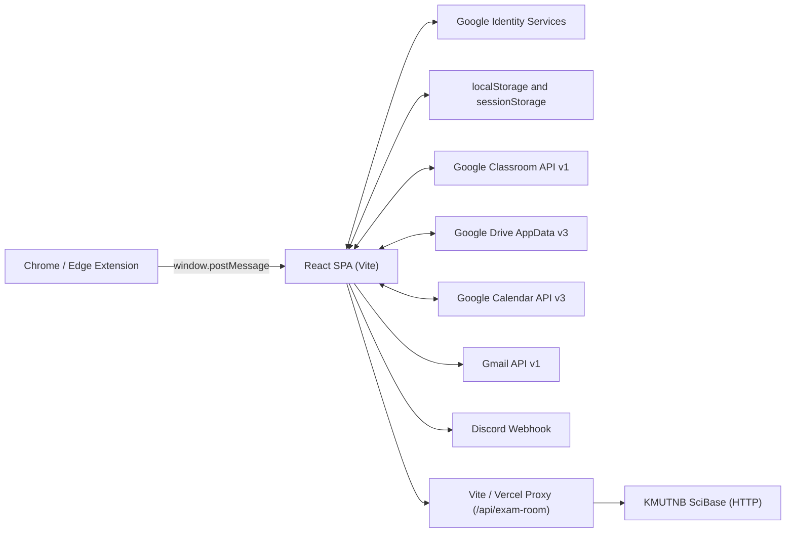

# Architecture

CH Classroom Hub is a client-side React Single Page Application (SPA). Instead of running a custom database or backend server, it talks directly to Google APIs, keeps a local cache in `localStorage` for instant loads, and uses Google Drive's hidden `appDataFolder` to sync user state across devices.

## System Overview



## Contexts and State

Global state is split across focused React Contexts in `src/contexts/`:

- `AuthContext`: Manages the Google GIS token client, `accessToken`, silent refresh, remembered account state, and full cache cleanup on explicit logout.
- `SettingsContext`: Holds language (`th` / `en`), alert preferences, notification history, and daily email quota counters.
- `ClassroomContext`: Orchestrates syncing, exposes courses/assignments/resources/topics/schedule/academic data, and listens for snapshots from the companion Reg extension.
- `ClassroomUIContext`: Derives `visibleCourses`, `visibleAssignments`, and `visibleResources` by applying `hiddenCourseIds` and manages pinned items without mutating raw synced arrays.
- `ToastContext`: Manages transient toast alerts.

Feature-specific logic (such as `useExamRoom`) and reusable hooks (`useExams`, `useTodayClasses`, `useDashboardFilters`, `useBackgroundSync`) sit in `src/features/` and `src/hooks/`.

## Storage and Caching

- `sessionStorage` stores the active OAuth access token (`classroom_hub_access_token`) and its expiration timestamp (`classroom_hub_access_token_expires_at`).
- `localStorage` stores user data keyed by lowercase email (`${baseKey}_${email}`, for example `classroom_hub_assignments_student@kmutnb.ac.th`) so switching Google accounts never leaks state.
- `StorageRepository` keeps an in-memory `Map` cache over `localStorage` reads and handles quota eviction when storage fills up.

## Sync Pipeline

When `syncClassroom` runs in `ClassroomContext`:

1. **Parallel fetch**: When the active email is already known, profile lookup, Google Drive sync, and Classroom data fetching start together via `Promise.all`.
2. **Classroom batching**: `ClassroomService.fetchClassroomData` requests `pageSize=100` across Classroom endpoints, skips feeds for courses already marked hidden in `hiddenCourseIds` (while preserving their cached items and refreshing automatically if unhidden later), and runs up to 5 courses concurrently via a worker pool.
3. **Granular failure protection**: If one feed (such as `submissions` or `announcements`) fails for a course, the app keeps the previous cached items for that feed instead of wiping them.
4. **Drive merge and metadata fast-path**: `SyncManager` and `driveSync.js` check `file.modifiedTime` on Drive before downloading `classroom_hub_sync_settings.json`. When both remote `modifiedTime` and local state match the last sync, Drive download and upload are skipped. Otherwise, `SyncManager` merges collections item-by-item using field-level timestamps (`updatedAt`, `statusUpdatedAt`) and deletion tombstones (`classroom_hub_deleted_ids_*`).
5. **Non-blocking post-sync**: Once Classroom state updates in the UI, `isSyncing` stops immediately while `NotificationService`, `CalendarSyncManager`, and any queued Drive push finish in the background.

## Directory Structure

```text
src/
  components/       Shared layout, navigation, modals, and dashboard widgets
  config/           App constants, OAuth scopes, storage keys, exam and sync flags
  contexts/         React Context providers
  features/         Feature-specific components and hooks (e.g., exams)
  hooks/            Reusable React hooks
  pages/            Lazy-loaded route views
  repositories/     Google API wrappers, StorageRepository, examRepository
  services/         SyncManager, CalendarSyncManager, NotificationService, Discord, parsers
  types/            TypeScript models
  utils/            httpClient, Result helpers, sanitizers, date/grade/schedule utilities
extension/          Chrome/Edge Manifest V3 extension for KMUTNB Reg auto-sync
tests/              Vitest unit and component tests
docs/               Documentation and ADRs
```
